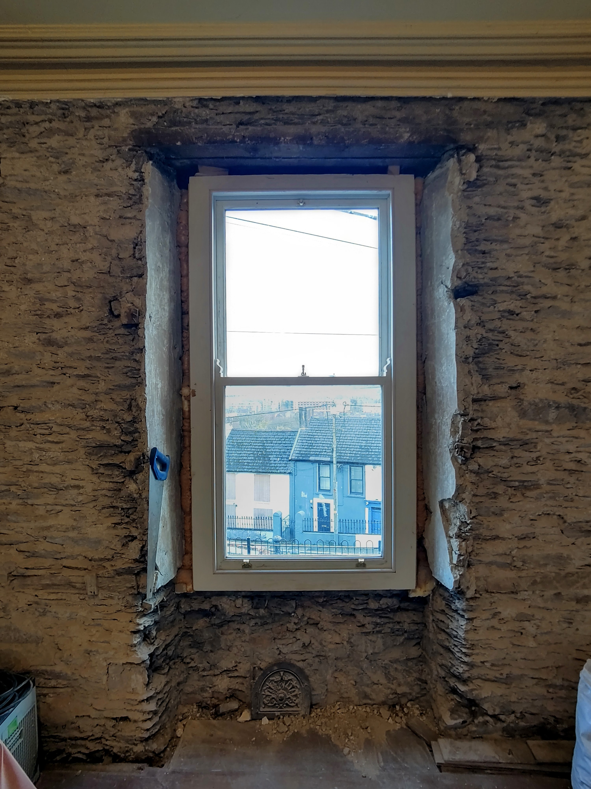
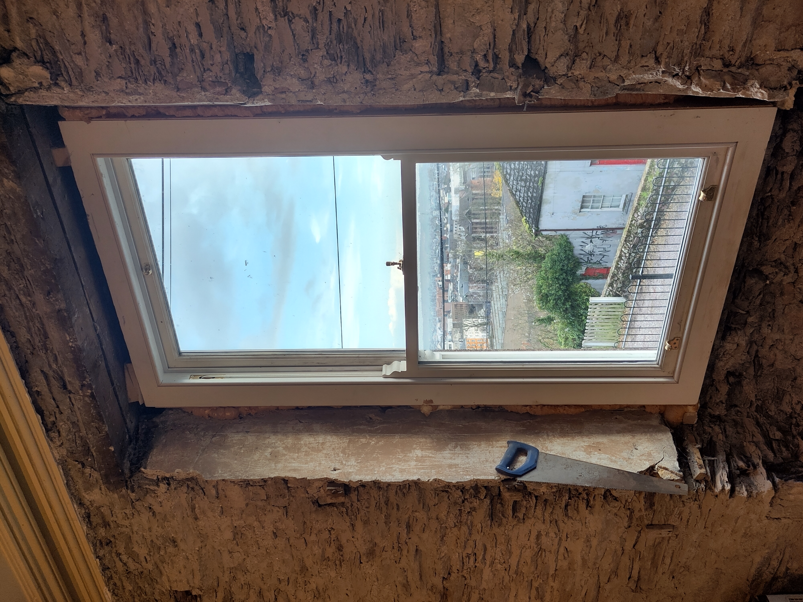
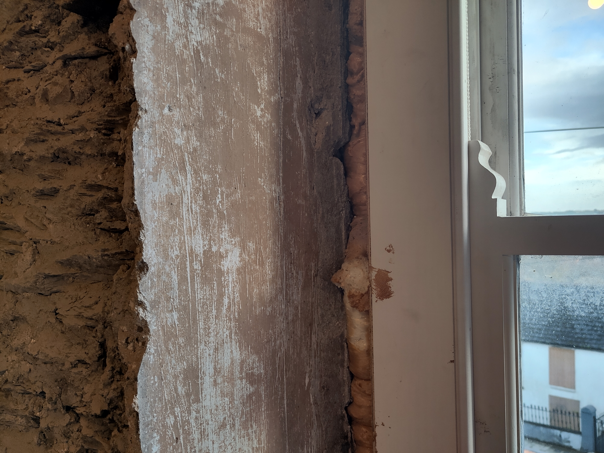
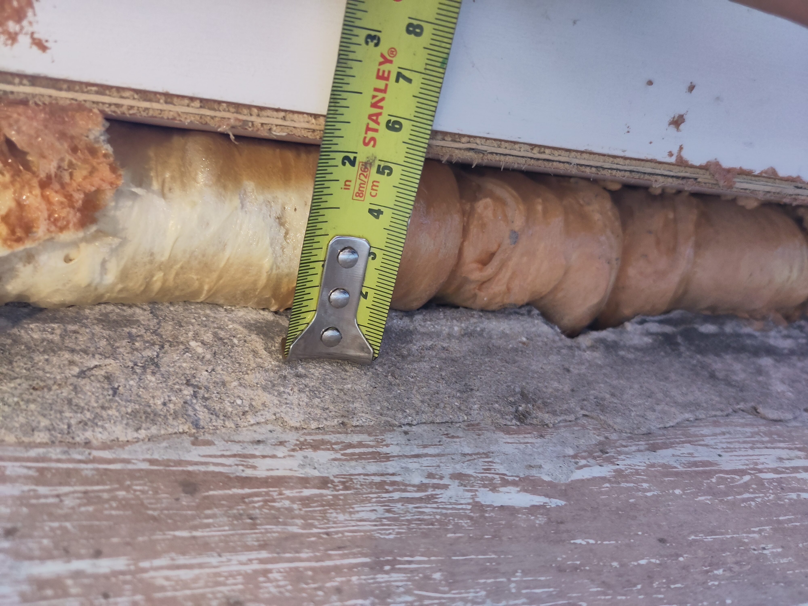
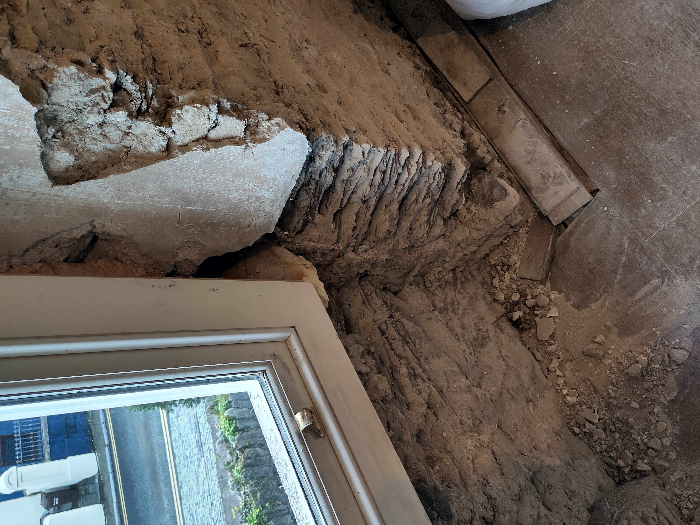
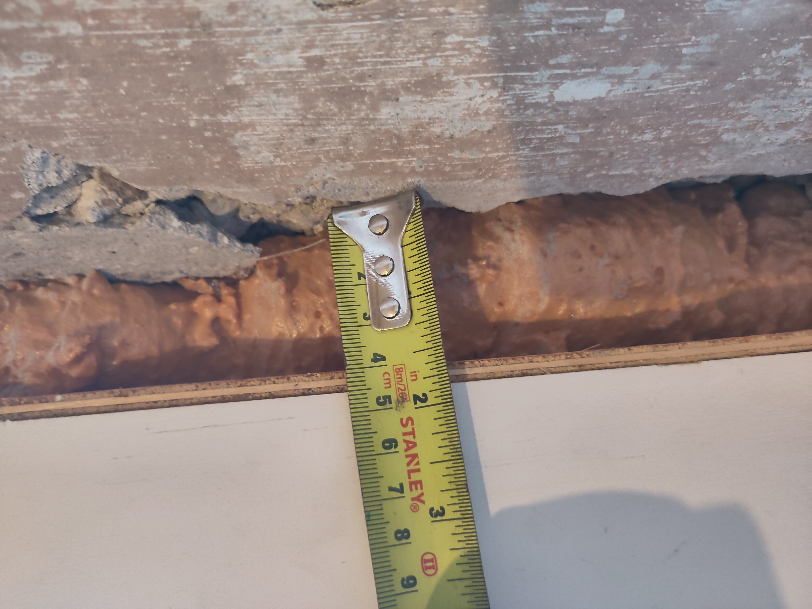
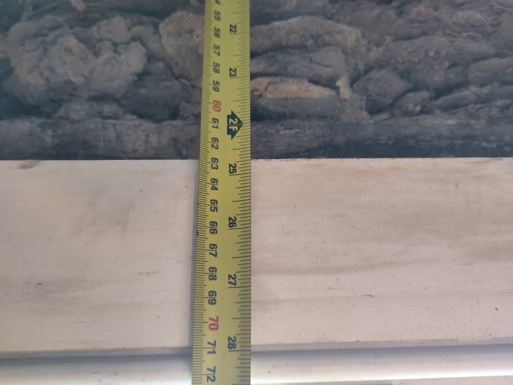
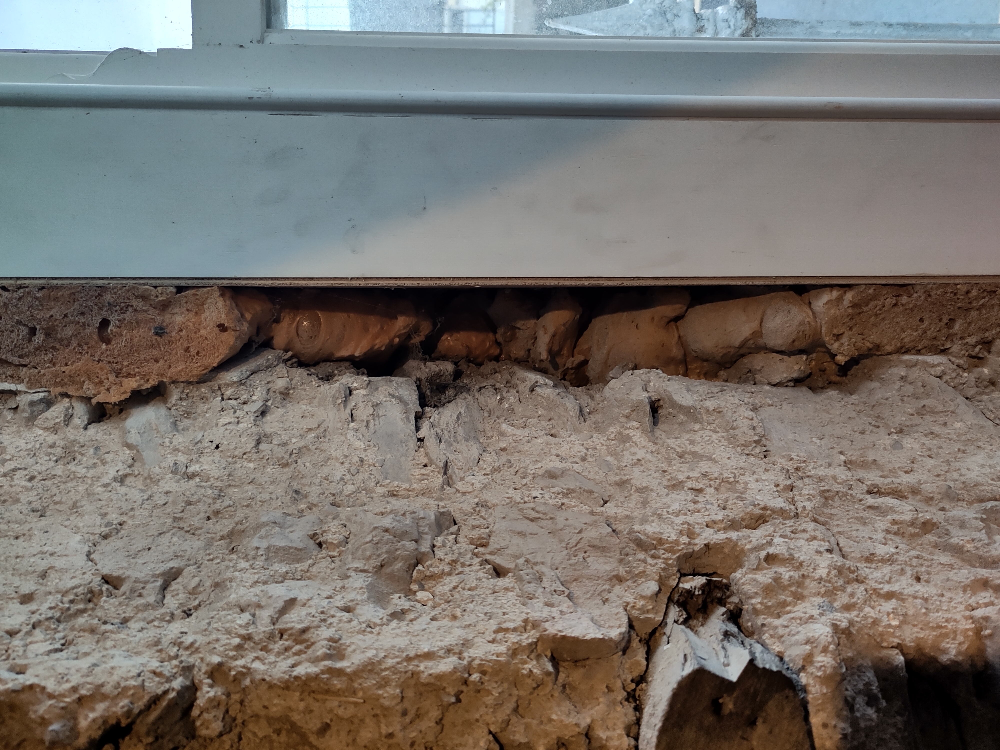
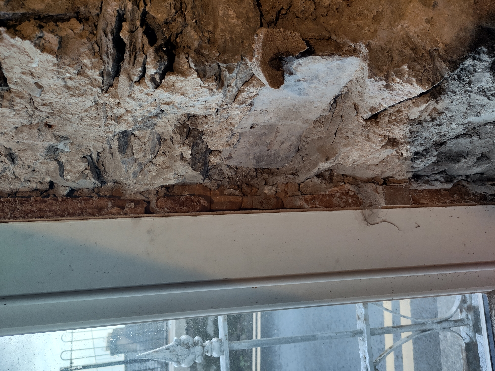

# Window reveals

## Upstairs

**Full view, wide**

**Full view, closer**

**Full view, side**

### Left reveal

### Right reveal

### Underneath

Currently very narrow. About 2ft high.

### Thermal

WIndow is facing SSE, there was some sunshine today so there appears to be residual heat from this captured on and below the stone window sill.

**Left reveal, underside and frame**

**Right reveal, underside and frame**

### Window dimensions

Windows are Accoya with double glazing.

**Height**

**Width**

## Downstairs

A couple of images of the downstairs reveals which are almost completely stripped back to stone.

**Left reveal, stripped back**

**Right reveal, stripped back**

