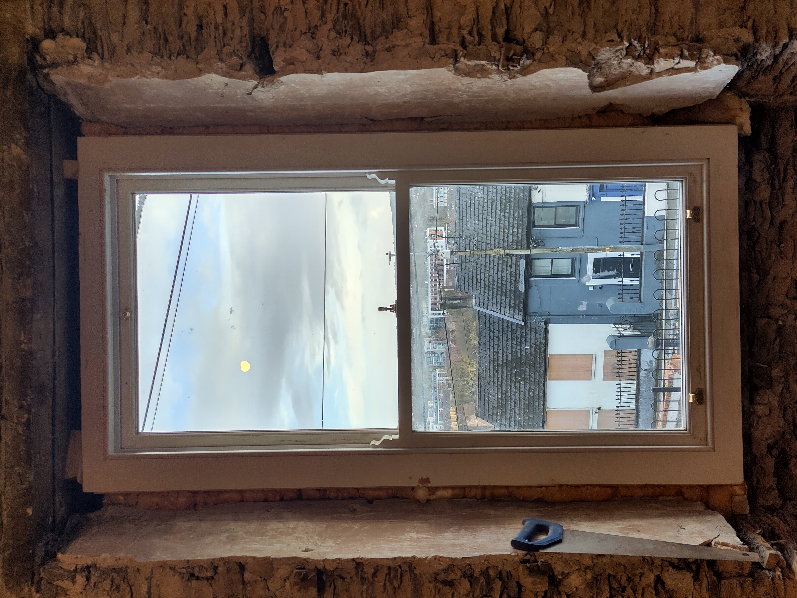
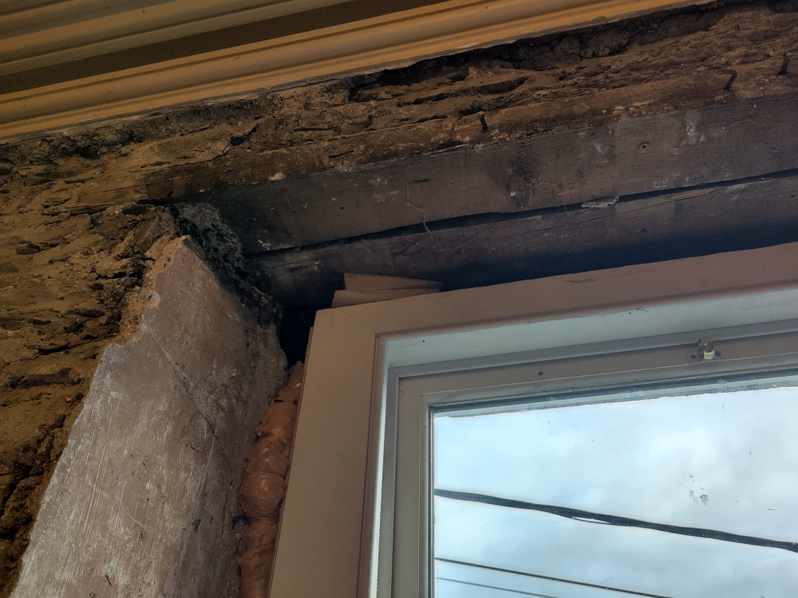
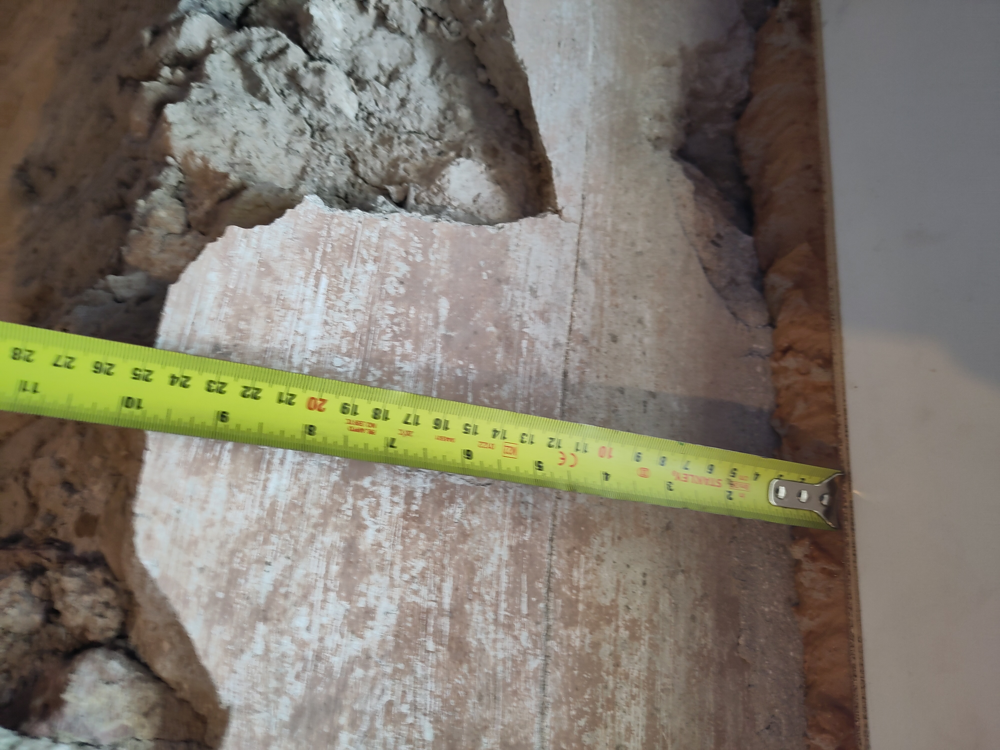
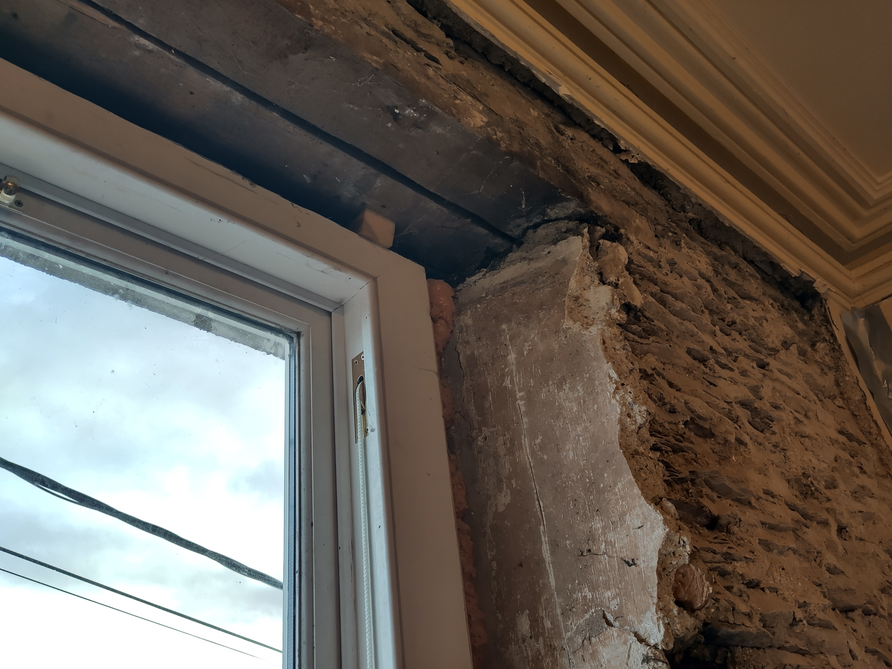
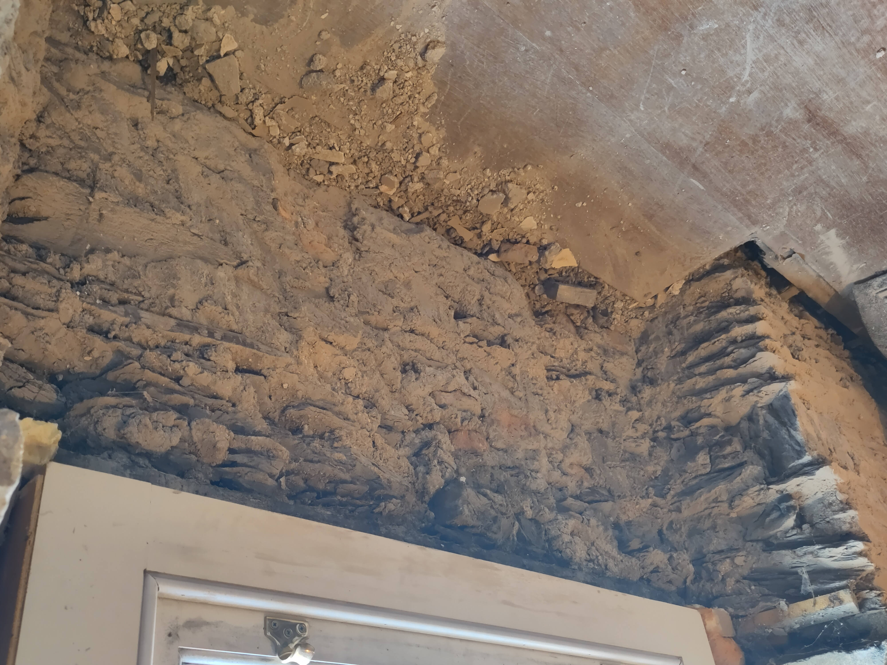
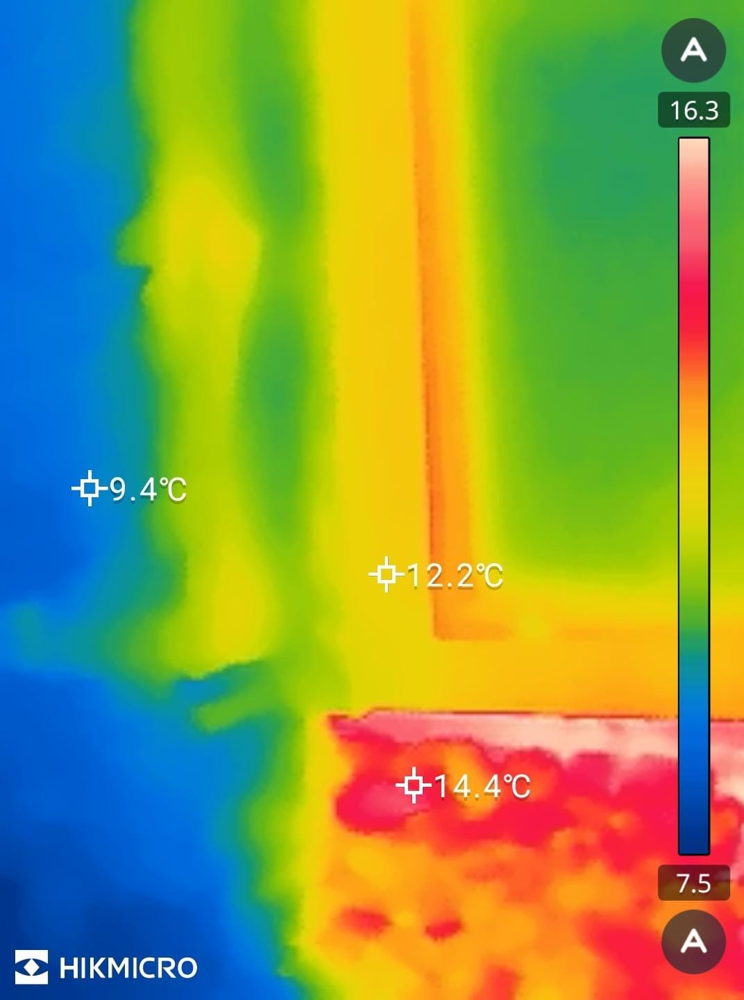
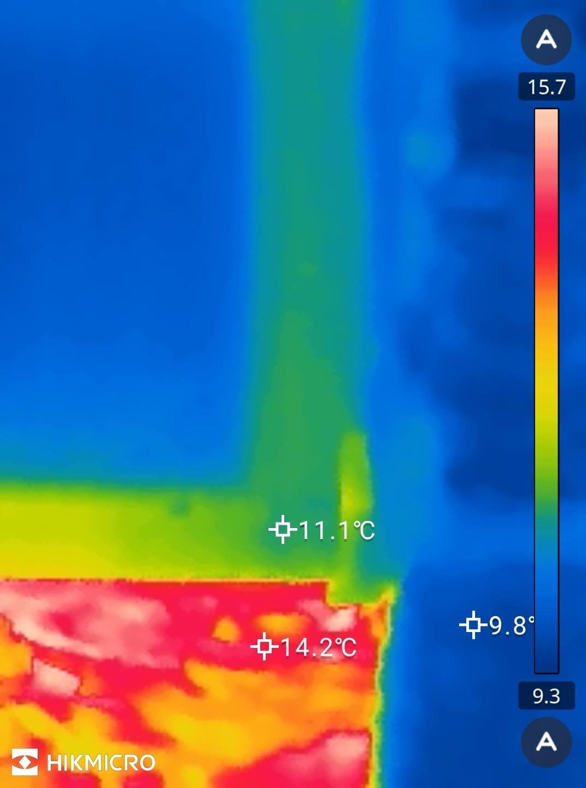
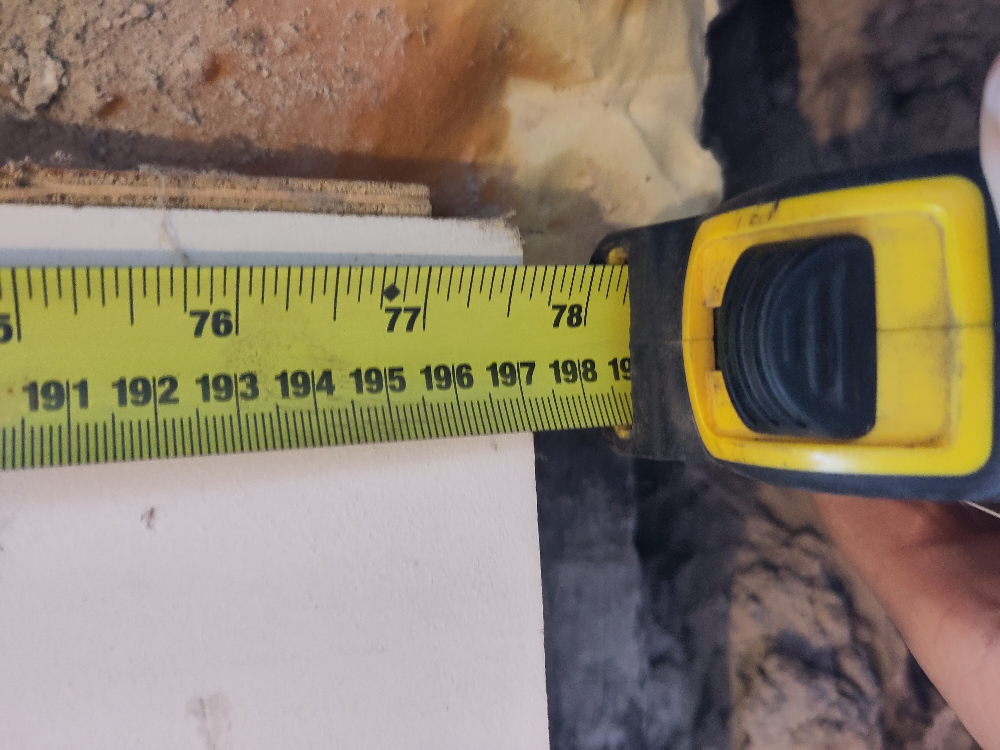
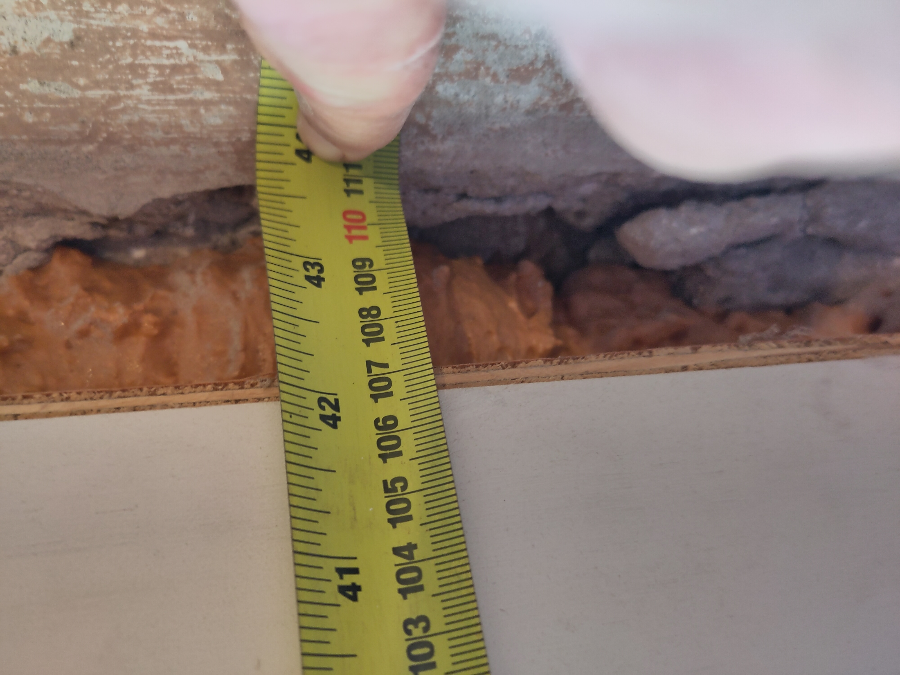

# Window reveals

Photo documentation of window reveal condition and measurements upstairs and downstairs. Files are ordered and grouped so contractors, trades, or future reference can follow the same story without digging through a timeline album.

## Index

- [Upstairs](#upstairs)
- [Downstairs](#downstairs)

## Upstairs

### Full view

**00 — Full view**

**01 — Full view**

### Side detail

**02 — Side detail**

### Left reveal

**03 — Left reveal, side**

**04 — Left reveal, gap**

**05 — Left reveal, top**

### Right reveal

**06 — Right reveal, side**

**07 — Right reveal, side (detail)**

**08 — Right reveal, gap**

**09 — Right reveal, top**

### Beneath

**10 — Beneath (measurement)**

**11 — Beneath**

### Thermal

**12 — Thermal 1**

**13 — Thermal 2**

### Window dimensions

**14 — Window height**

**15 — Window width**

## Downstairs

**Left reveal, stripped back**

**Right reveal, stripped back**

